# LINE GUARD — Solar-Powered LoRaWAN Smart Pipeline Monitoring & Control


> **Capstone Design Project I — Group 1**  
> Bachelor of Science in Electrical Engineering · Higher Colleges of Technology, Sharjah Campus  
> **Progress report date:** 6 November 2026

LINE GUARD is a proposed solar-powered IoT system for monitoring remote water, oil and gas pipeline sections. It is designed to detect abnormal operating conditions, identify the affected pipeline segment, and support remote isolation without depending on mains power or wired/cellular infrastructure at every field node.

This repository-style project page summarizes the design and preliminary work documented in the CDP I progress report. It distinguishes completed design and preliminary tests from features planned for implementation and verification in CDP II.

---

## Contents

- [Problem](#problem)
- [Proposed solution](#proposed-solution)
- [System architecture](#system-architecture)
- [Hardware design](#hardware-design)
  - [Main controller PCB](#main-controller-pcb)
  - [Solar power PCB](#solar-power-pcb)
  - [Sensors and valve control](#sensors-and-valve-control)
  - [Wireless communication and GPS](#wireless-communication-and-gps)
- [Leak detection and machine learning](#leak-detection-and-machine-learning)
- [Power budget](#power-budget)
- [Work completed in CDP I](#work-completed-in-cdp-i)
- [CDP II implementation plan](#cdp-ii-implementation-plan)
- [Project objectives](#project-objectives)
- [Repository structure](#repository-structure)
- [Team](#team)
- [Project status and limitations](#project-status-and-limitations)

---

## Problem

Remote pipeline sections may not have reliable grid power or wired communication. When operators depend on periodic site visits, leaks, abnormal pressure, and valve faults can remain unnoticed between inspections.

LINE GUARD addresses this monitoring gap through distributed field nodes that collect measurements and communicate with a gateway over a low-power long-range wireless link. The system is intended to shorten the time between a fault occurring, its detection, and the isolation of the affected section.

## Proposed solution

Each field node is designed around an **ESP32-S3** and two custom PCBs:

1. **Main PCB** — controller, radio, GPS, sensor interfaces, local storage, display, and valve driver.
2. **Power PCB** — solar MPPT charging, battery connection, and regulated 12 V, 5 V, and 3.3 V rails.

The field node is designed to measure:

- Pipeline pressure
- Water flow
- Temperature
- Pipe vibration
- GPS position and time

The node stores readings locally and sends compact telemetry through a **REYAX RYLR993_Lite LoRaWAN module**. A gateway and dashboard are part of the overall system architecture; the report assigns gateway/dashboard development to Group 2. Leak detection is intended to combine flow/pressure rules with vibration-based machine learning. A motorized valve can be commanded to isolate a section, with closure checked indirectly using the flow sensor.

## System architecture

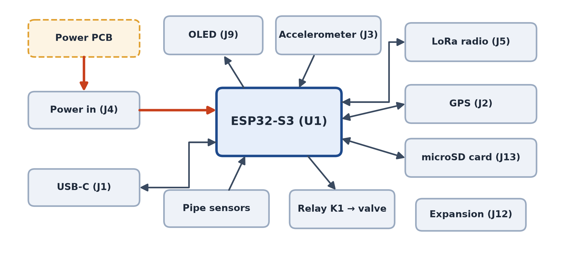

**Conceptual data path:** field sensors → ESP32-S3 field node → LoRaWAN → gateway/network server → database/dashboard. The node also logs measurements locally to microSD and controls its motorized isolation valve.

The proposed network uses a **star topology**: each field node communicates directly with one gateway; nodes do not relay messages for one another.

---

# Hardware design

## Main controller PCB

The main PCB is the field node's central control board. It is designed as a two-layer, 100 × 80 mm board and integrates the controller and field interfaces.

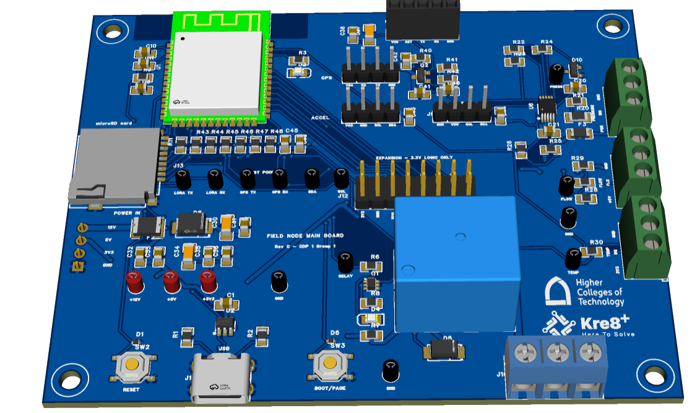

### Main-board functions

| Subsystem | Component / interface | Purpose |
|---|---|---|
| Microcontroller | ESP32-S3-WROOM-1-N8 | Runs node firmware and coordinates peripherals |
| LoRaWAN | REYAX RYLR993_Lite, UART1 | Long-range, low-power telemetry |
| GPS | GPS receiver, UART2 | Node location and time synchronization |
| Pressure | 4–20 mA transmitter + ADS1115 | Measures pipeline pressure |
| Flow | Hall-effect flow sensor | Measures flow through pulse counting |
| Temperature | DS18B20, 1-Wire | Measures water/pipe temperature |
| Vibration | MPU-6050, I²C | Captures pipe vibration for leak classification |
| Valve | 12 V motorized valve + relay driver | Opens or closes the pipeline valve |
| Local logging | microSD, SPI | Retains measurements if the radio link is unavailable |
| Local display | 1.3-inch OLED, I²C | Displays readings and radio status |

### Main PCB design details

- Two-layer FR-4 board, 1.6 mm thickness.
- Ground pours on both layers.
- Copper keep-out beneath the ESP32 antenna region.
- Design-rule checks were run until no errors remained, as stated in the progress report.
- Test points and an expansion header are included to support board bring-up and future extensions.
- The board receives its 12 V, 5 V, and 3.3 V rails from the separate Power PCB.

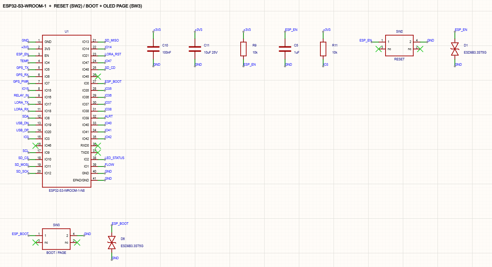

## Solar power PCB

The dedicated Power PCB is designed to sit beneath the Main PCB in a stacked arrangement. Separating the switching power circuitry from the sensing and radio circuitry is intended to reduce electrical noise and prevent valve-motor current transients from disturbing the controller supply.

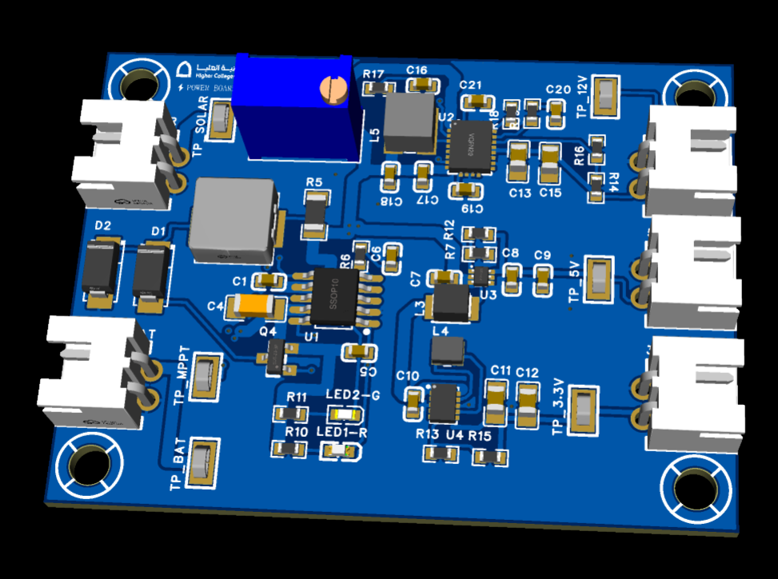

### Power architecture

| Power stage | Main component | Function |
|---|---|---|
| Solar charging / MPPT | CN3791 | Charges the single-cell LiPo battery from the solar panel |
| 12 V boost | TPS61088 | Supplies the pressure transmitter, relay coil, and motorized valve |
| 5 V boost | TPS61023 | Supplies the flow sensor and relay driver |
| 3.3 V buck-boost | TPS63802 | Provides a regulated logic rail across the battery discharge range |

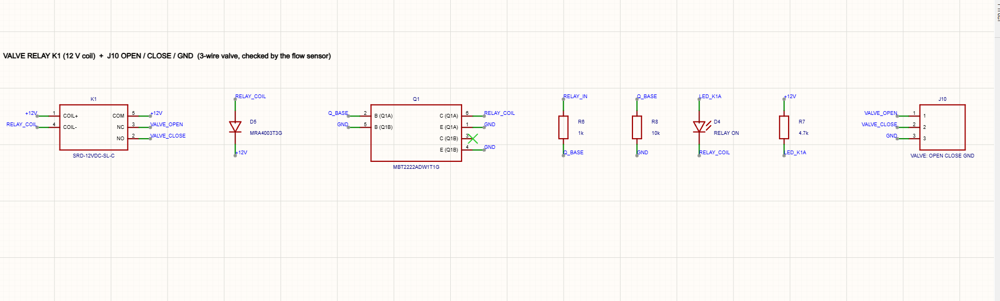

### Power-stage schematics

| MPPT charger | 12 V boost converter |
|---|---|
| 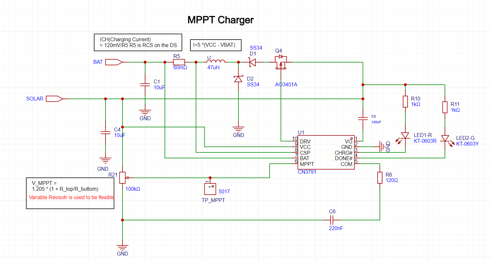 | 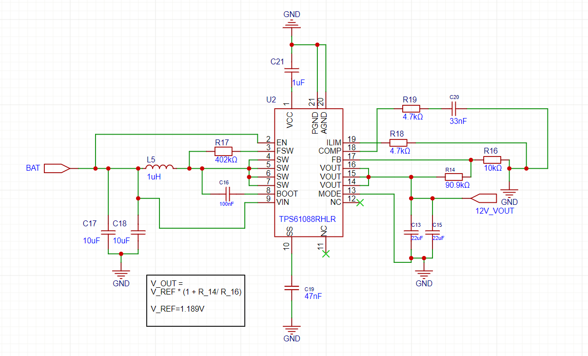 |

| 5 V boost converter | 3.3 V buck-boost converter |
|---|---|
| 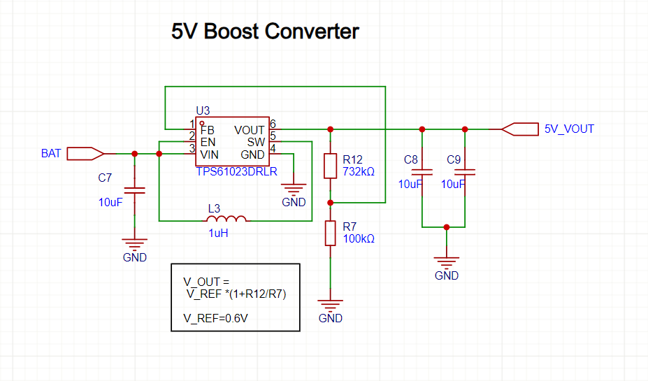 | 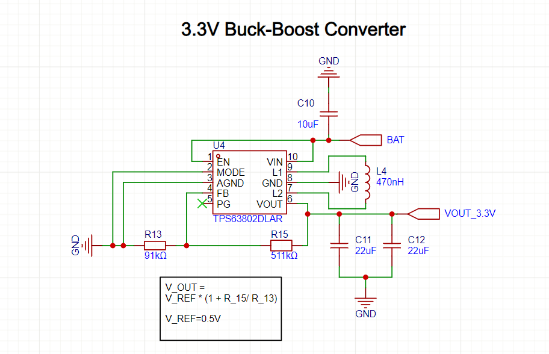 |

The report specifies the following supply requirements for the Main PCB:

| Rail | Loads | Minimum current requirement |
|---|---|---:|
| 3.3 V | ESP32-S3, radio, GPS, microSD, ADC, accelerometer, OLED, temperature sensor | 600 mA |
| 5 V | Flow sensor and relay driver | 300 mA |
| 12 V | Pressure transmitter, valve motor, relay coil | 1 A while the valve is moving |

## Sensors and valve control

### Pressure measurement

The pressure transmitter provides a 4–20 mA signal. The design converts this current to a voltage using a precision resistor and measures it with an ADS1115 16-bit ADC over I²C. The report documents a 75 Ω precision resistor, giving a nominal 0.30–1.50 V measurement span.

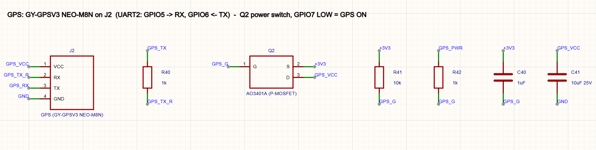

### Flow measurement

The Hall-effect flow sensor produces pulses proportional to flow. The ESP32 counts the pulses through a GPIO input. A resistor divider and pull-up are included to keep the signal within the ESP32 input-voltage range.

### Temperature measurement

A waterproof DS18B20 digital probe connects to the ESP32 through a 1-Wire interface and uses a 4.7 kΩ pull-up resistor.

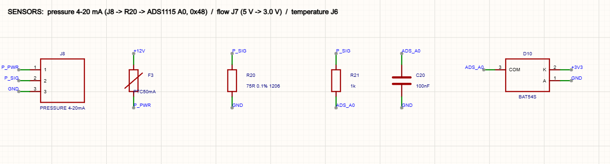

### Valve control

A 12 V motorized brass ball valve is driven through a relay. The ESP32 controls the relay through an NPN transistor driver. The design energizes only one valve direction at a time.

The valve does not provide position-feedback wires. Therefore, the proposed firmware checks closure indirectly: after a CLOSE command, flow should fall to approximately zero within the specified time; otherwise, a valve fault is reported.

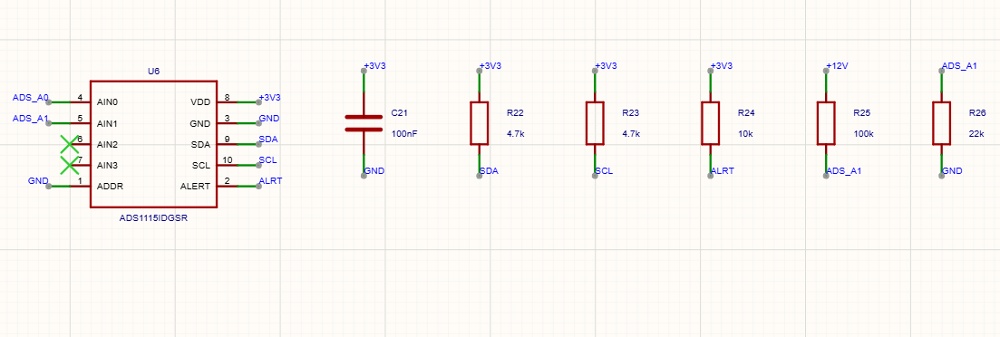

### Local data and display

The main board includes a microSD interface for local data logging and an OLED display for on-site status checks. Local logging is intended to preserve readings during temporary radio outages.

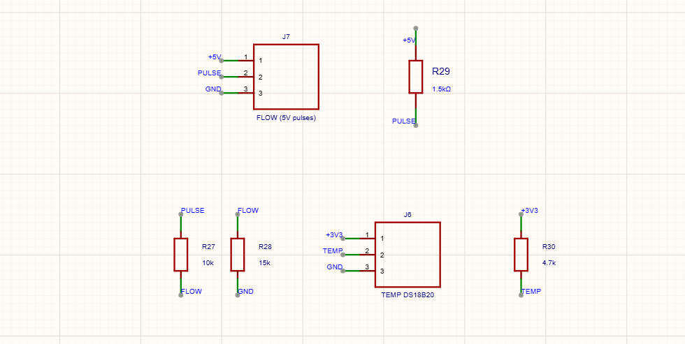

## Wireless communication and GPS

The selected radio module is the **REYAX RYLR993_Lite**, connected to the ESP32-S3 through UART1. The report describes its AT-command configuration and the use of LoRaWAN mode.

The documented LoRaWAN setup includes:

- EU868 frequency-band configuration to match the selected SX1302 gateway.
- OTAA activation.
- Per-device DevEUI and security credentials.
- Registration of three end devices in a local ChirpStack application.
- AT commands for checking module communication, configuring the band and credentials, and initiating the join procedure.

The GPS receiver uses a separate UART interface. A MOSFET-controlled power switch is included so GPS can be powered only when needed for location/time updates.

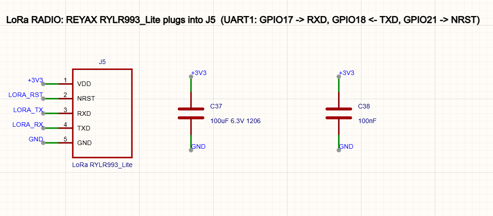

> **Security note:** Do not commit real DevEUI/JoinEUI/AppKey/NwkKey values, Wi-Fi credentials, server passwords, or other secrets to a public repository. Use placeholders in example configuration files and keep actual keys outside version control.

---

# Leak detection and machine learning

The proposed leak-detection approach combines two complementary sources of evidence:

1. **Flow and pressure monitoring:** compares readings and looks for abnormal pressure/flow patterns between neighboring nodes.
2. **Vibration classification:** an MPU-6050 accelerometer mounted on the pipe records vibration windows. A machine-learning model classifies the vibration as leak or no-leak.

The report describes preprocessing vibration into 3-second windows and comparing the vibration level with a normal baseline before passing relevant windows to the classifier.

### Model comparison

Six model approaches were compared using a public vibration dataset: LDA, logistic regression, SVM, random forest, 1D CNN, and 1D CNN with augmentation. The report notes that evaluation on complete recordings not seen during training is more representative than a random window split.

The reported comparison selected a 1D CNN as the candidate model. The report gives approximately 87% accuracy for the 1D CNN on unseen recordings, compared with approximately 66% for SVM. These are preliminary dataset results, not validated field-test performance.

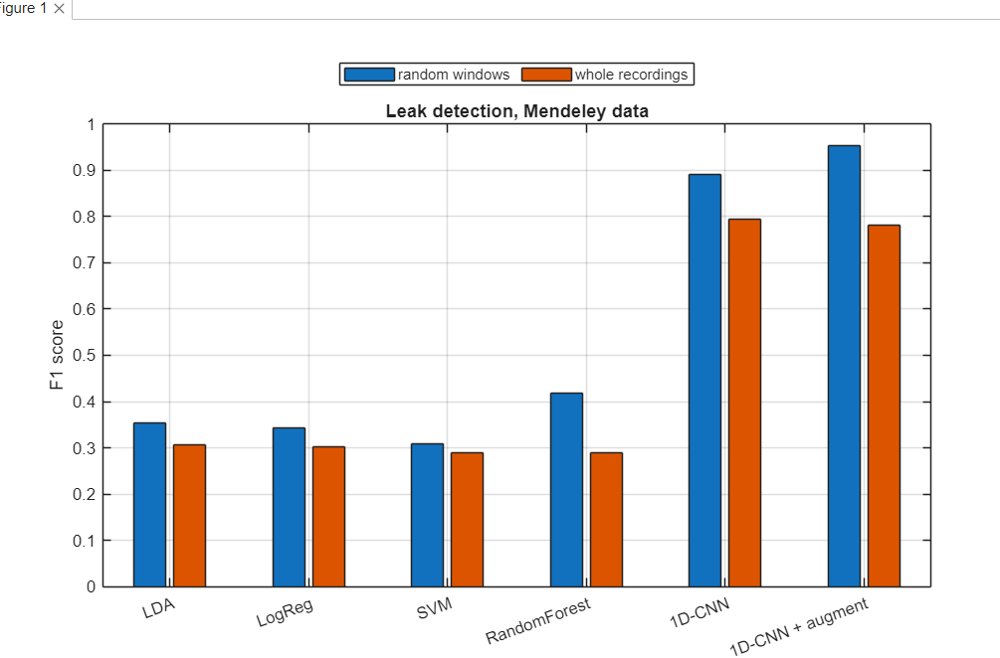

### Planned embedded inference

The model is intended to run on the ESP32-S3 using a TinyML deployment approach. Instead of transmitting raw high-rate vibration data, the node is intended to transmit a compact classification result. Quantization, inference time, memory use, and energy consumption remain to be measured during CDP II.

---

# Power budget

The progress report estimates a total continuous daily energy demand of approximately **6.34 Wh/day** under its stated assumptions.

| Item | Reported daily energy |
|---|---:|
| ESP32-S3 | 4.8000 Wh |
| Pressure transmitter | 1.4400 Wh |
| Motorized valve | 0.0533 Wh |
| Flow sensor | 0.0280 Wh |
| LoRaWAN radio | 0.0132 Wh |
| microSD logging | 0.0026 Wh |
| GPS receiver | 0.0007 Wh |
| MPU-6050, DS18B20 and ADS1115 | 0.0003 Wh |
| **Total** | **6.3381 Wh/day** |

The design analysis selects a 6 V, 3 W solar panel and estimates battery autonomy using a 10 Ah LiPo pack and an 80% usable-capacity allowance. These are design calculations and assumptions from CDP I; the autonomy target still requires physical verification.

---

# Work completed in CDP I

The progress report documents the following preliminary work:

- Defined the engineering problem, stakeholders, scope, requirements, and measurable project objectives.
- Developed the overall system architecture and selected the star-topology LoRaWAN approach.
- Designed the Main PCB and dedicated Power PCB, including circuit interfaces and board layouts.
- Documented the ESP32-S3 pin assignment and interfaces for sensors, radio, GPS, storage, display, and valve control.
- Prepared a sensor-test sketch and performed breadboard tests of the flow, temperature, and GPS circuits.
- Documented the pressure-sensor test as pending availability of a suitable 12 V supply at the time of the report.
- Registered three LoRaWAN end devices in a local ChirpStack setup and documented OTAA configuration.
- Compared vibration-based machine-learning models using a public dataset and selected a 1D CNN candidate.
- Prepared the CDP II work breakdown structure, schedule, milestones, and verification plan.

**Important:** The report does not present the complete three-node system as a finished, field-validated prototype. PCB assembly, full integration, calibration, leak trials, valve verification, radio-reliability testing, and the 72-hour autonomy test are planned for CDP II.

---

# CDP II implementation plan

The report plans a 14-week implementation period to turn the CDP I designs into three field nodes on a DN25 water test loop.

| Work package | Planned work | Planned deliverable |
|---|---|---|
| WP1 — Design check and preparation | Review design and plan; inspect received parts | Approved plan and checked parts list |
| WP2 — Hardware build | Assemble three Main PCBs and three Power PCBs; build enclosures and test loop | Three assembled nodes and working test loop |
| WP3 — Firmware and software | Implement sensing, logging, OLED, valve control, LoRaWAN link, and AI model | Node firmware, platform link, trained leak model |
| WP4 — Integration and testing | Board bring-up, calibration, integration, leak/valve/radio/autonomy tests | Calibrated nodes and test results |
| WP5 — Analysis and documentation | Analyse results and complete final report | Analysis and final report |
| WP6 — Presentation | Final presentation and live demonstration | Demonstration and submission |

The gateway and dashboard are assigned to Group 2, with joint integration and radio-link testing planned.

---

# Project objectives

The report defines the following acceptance targets for CDP II. They are **targets, not achieved results**.

| Area | Target defined in the report |
|---|---|
| Requirements and architecture | Requirements traceable to objectives and architecture reviewed |
| PCB design | No unresolved DRC errors; interfaces mapped to connectors, protection, and test points |
| Sensor calibration | Pressure and flow within ±5%; temperature within ±1.0 °C |
| LoRaWAN reliability | At least 95% of 200 uplinks received |
| Leak detection | Alarm within 60 seconds for a sustained flow imbalance of at least 20%; false alarms no more than 5% over the defined trials |
| Vibration model | F1 score of at least 0.80 on recordings not used in training |
| Leak localisation | Correct segment in at least 8 of 10 staged leaks |
| Valve isolation | Flow below 5% of pre-closure value within 15 seconds in at least 19 of 20 trials |
| Power autonomy | 72 hours of operation without solar charging, without brownout or reset |

---

# Repository structure

A suggested structure for the complete GitHub project is:

```text
line-guard/
├── README.md
├── assets/
│   ├── line-guard-logo.png
│   ├── system-architecture.png
│   ├── main-pcb-3d-render.png
│   ├── main-pcb-schematic-overview.png
│   ├── power-pcb-3d-render.png
│   ├── power-pcb-circuit-overview.png
│   ├── mppt-charger-circuit.png
│   ├── 12v-boost-circuit.png
│   ├── 5v-boost-circuit.png
│   ├── 3v3-buck-boost-circuit.png
│   └── ...
├── firmware/
│   ├── field-node/
│   └── sensor-test/
├── hardware/
│   ├── main-pcb/
│   ├── power-pcb/
│   └── bom/
├── machine-learning/
│   ├── dataset-notes/
│   ├── training/
│   └── evaluation/
├── documentation/
│   ├── progress-report/
│   └── test-results/
└── LICENSE
```

Only add folders and files when you have the corresponding source files ready. The images in `assets/` are extracted from the CDP I progress report; they are report figures, not substitutes for editable PCB project files, Gerbers, firmware source, or raw experimental data.

---

# Team

**Group 1 — Bachelor of Science in Electrical Engineering, HCT Sharjah Campus**

- Abel Mhret
- Amanuel Alebachew
- Eden Yoseph
- Efa Kedir
- Filmon Nezif
- Salim Mohamed Khamis
- Almutawa Alsuwaidi

**Project supervisor:** Dr. Sofian Saidi

---

# Project status and limitations

This project is a capstone prototype and research/design exercise. The planned demonstration uses a low-pressure water test rig. The report places live utility deployment, production deployment, certified hazardous-area equipment, and tests using oil or gas outside the project scope.

The oil and gas application is addressed at concept and requirements level; the planned physical validation is on a water test loop. The system is not intended to replace commercial SCADA or certified pipeline safety systems.

---

## Acknowledgement

This README is based on the **CDP I Progress Report — Solar-Powered LoRaWAN Smart Pipeline Monitoring and Control System: Group 1**, submitted on 6 November 2026. Technical specifications, design descriptions, preliminary results, and future plans are summarized from that report. Figures included here are extracted from the report.
